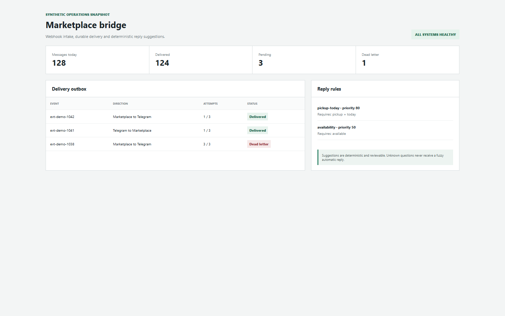
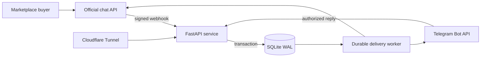

# Marketplace Telegram Bridge

[English / README principal](README.md) · Português (Brasil)

[](https://github.com/santosgus3dtech/marketplace-telegram-bridge/actions/workflows/checks.yml)
[](https://www.python.org/)
[](https://fastapi.tiangolo.com/)



Uma ponte segura e orientada a eventos entre a API oficial de chat da OLX e o Telegram. Ela encaminha
conversas do marketplace para um chat autorizado do Telegram e envia as respostas de volta pela
API oficial do provedor.

Este repositório público é uma edição de portfólio sem dados sensíveis. Não contém credenciais de produção,
histórico de mensagens, banco de dados, identificadores pessoais ou configuração privada de implantação.

## Por que este projeto importa

A parte interessante não é mover texto entre duas APIs. O serviço foi projetado em torno dos
modos de falha que aparecem em integrações reais:

- webhooks duplicados ou reenviados;
- rotação de tokens OAuth e persistência criptografada;
- APIs externas lentas ou indisponíveis;
- reinícios do processo durante a entrega;
- usuários ou chats não autorizados do Telegram;
- limites de requisições do provedor e falhas transitórias;
- retenção de dados de mensagens e eventos de auditoria operacional.

## Arquitetura



Os webhooks recebidos persistem a mensagem e uma tarefa na fila de saída na mesma transação de banco de dados. Um
processador em segundo plano assume tarefas com bloqueios de propriedade, aplica recuo exponencial limitado e
move as tarefas que esgotaram as tentativas para um estado de falha definitiva. A requisição HTTP nunca espera por uma API externa.

## Destaques de engenharia

- FastAPI assíncrono, HTTPX e SQLAlchemy 2.x.
- OAuth 2.0 com valores de `state` que expiram e podem ser usados uma única vez.
- Tokens do provedor criptografados em repouso.
- Idempotência para IDs de mensagens do provedor e IDs de atualizações do Telegram.
- Fila de saída durável com recuperação após reinício, expiração de bloqueios e tratamento de falhas definitivas.
- Segredo de webhook do Telegram, além de listas de chats e usuários permitidos.
- Limites de tamanho das requisições, limitação local de requisições e reforço de segurança do OpenAPI em produção.
- SQLite WAL, migrações Alembic e scripts de backup e restauração com o banco em uso.
- Retenção configurável de mensagens e registros de auditoria.
- Reforço de segurança do Docker: sistema de arquivos somente para leitura, remoção de capacidades e no-new-privileges.
- Cenários unitários, de integração e de ponta a ponta com serviços externos simulados.
- Sugestões de resposta determinísticas e baseadas em prioridade, que rejeitam correspondências aproximadas e permanecem disponíveis para revisão antes do envio.

## Tecnologias

`Python 3.12+` · `FastAPI` · `Pydantic Settings` · `SQLAlchemy` · `Alembic` ·
`SQLite` · `HTTPX` · `cryptography` · `pytest` · `Docker Compose` · `Cloudflare Tunnel`

## Desenvolvimento local

```bash
python -m venv .venv

# Linux/macOS
source .venv/bin/activate

# Windows PowerShell
.venv\Scripts\Activate.ps1

python -m pip install -e ".[dev]"
cp .env.example .env
```

Gere uma chave de criptografia e coloque-a em `.env`:

```bash
python -c "from cryptography.fernet import Fernet; print(Fernet.generate_key().decode())"
```

Para verificações locais, mantenha as credenciais externas vazias e execute:

```bash
alembic upgrade head
uvicorn app.main:app --reload
```

Endpoints de saúde:

- `GET /health` verifica o processo.
- `GET /ready` verifica o acesso ao banco de dados.

## Verificação

```bash
ruff check .
ruff format --check .
pytest -q
```

A suíte de testes cobre OAuth, validação de webhooks, autorização, eliminação de duplicatas, novas tentativas de entrega,
comportamento de falhas definitivas, retenção, migrações e as duas direções de mensagens.

## Implantação em contêiner

```bash
cp .env.example .env
docker compose -f deploy/docker-compose.yml build app
docker compose -f deploy/docker-compose.yml run --rm --no-deps app alembic upgrade head
docker compose -f deploy/docker-compose.yml up -d app
bash scripts/check.sh
```

O exemplo vincula o serviço ao endereço de loopback. Um proxy reverso ou túnel deve terminar a conexão HTTPS e
encaminhar as requisições para essa porta local. Substitua `bridge.example.com` em `.env` e no exemplo do túnel
por um domínio que você controle.

## Modelo de segurança

Segredos devem ficar apenas em `.env` ou em um gerenciador de segredos. Nunca inclua em commits segredos de cliente do provedor,
tokens de bots do Telegram, tokens de túnel ou chaves de criptografia. A aplicação também exige:

1. apenas APIs oficiais, sem coleta automatizada de páginas do marketplace;
2. um estado OAuth aleatório com TTL e consumo único;
3. tokens do provedor criptografados no banco de dados;
4. listas de chats e usuários permitidos do Telegram;
5. correlação das respostas com uma mensagem conhecida do marketplace;
6. validação rigorosa de webhooks e do tamanho do corpo das requisições;
7. novas tentativas limitadas e tratamento explícito de falhas permanentes;
8. remoção configurável de dados antigos de mensagens.

Consulte [`docs/ARCHITECTURE.md`](docs/ARCHITECTURE.md),
[`docs/SECURITY.md`](docs/SECURITY.md) e
[`docs/THREAT_MODEL.md`](docs/THREAT_MODEL.md) para o projeto detalhado.

## Ativação do provedor

A suíte automatizada não exige credenciais reais. Uma implantação real com a OLX exige uma
integração aprovada e credenciais emitidas pelo provedor. Configure as URLs de callback e de webhook apenas
depois que o HTTPS estiver disponível.

## Mapa do repositório

```text
app/
  api/          OAuth, health and webhook endpoints
  clients/      Provider and Telegram HTTP clients
  db/           Models, repositories and async sessions
  services/     Bridge, delivery, security and retention logic
alembic/        Database migrations
deploy/         Hardened Compose and tunnel examples
docs/           Architecture, API and security notes
scripts/        Operations, backup and webhook helpers
tests/          Unit, integration and end-to-end scenarios
```

## Licença

Licença MIT. Consulte [`LICENSE`](LICENSE).
